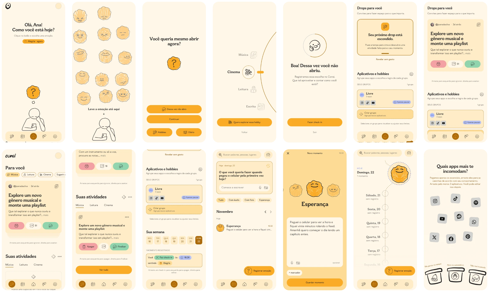

<div align="center">


<br>

**Uma pausa antes de abrir o app. Um diário das suas emoções. Hobbies para o tempo que sobrar.**

<br>

<a href="https://github.com/mvcordeiro/consi-app/releases/latest" target="_blank" rel="noopener noreferrer"></a>
<a href="https://docs.google.com/forms/d/e/1FAIpQLSeHnQlF08s3gLX79otICOQE-sh-Ni8dyouAGYJfmrOq5tdLYQ/viewform" target="_blank" rel="noopener noreferrer"></a>
<a href="https://github.com/mvcordeiro/consi-app/issues/new/choose" target="_blank" rel="noopener noreferrer"></a>


<a href="LICENSE" target="_blank" rel="noopener noreferrer"></a>

</div>

---

## O que é o Consi

Sabe quando você pega o celular para ver uma coisa e, quando percebe, passou meia hora? O Consi é um app para Android que entra nesse momento. Ele não bloqueia nada: antes de um app que você escolheu abrir, ele mostra uma pausa curta e pergunta se é isso mesmo que você quer agora. Você decide.

Junto com a pausa, o Consi tem um diário para registrar como você está e um espaço para os seus hobbies, com ideias de atividades para fazer no lugar do celular.

É para quem sente que abre alguns apps no automático, quer passar menos tempo dentro deles ou quer voltar a fazer coisas de que gosta.

> **Em piloto.** O Consi está em teste com um grupo pequeno de pessoas, só no Android, e muda com frequência.

## Um projeto acadêmico

O Consi foi criado para a avaliação final da disciplina **Design de Interação**, ministrada pelo professor <a href="https://institucional.ufpel.edu.br/servidores/id/5442" target="_blank" rel="noopener noreferrer">Tobias Mulling</a>, na **Universidade Federal de Pelotas (UFPel)**, no semestre 2026/2. Tem fins acadêmicos e foi desenvolvido em trio:

- **Miguel Valinho Cordeiro**, <a href="mailto:valinhocm@gmail.com" target="_blank" rel="noopener noreferrer">valinhocm@gmail.com</a>
- **Cássio Sias Pereira**, <a href="mailto:cassio.sp.2005@gmail.com" target="_blank" rel="noopener noreferrer">cassio.sp.2005@gmail.com</a>
- **Lorena Marques Vieira Medeiros**, <a href="mailto:lornastudys@gmail.com" target="_blank" rel="noopener noreferrer">lornastudys@gmail.com</a>

## Como funciona a pausa

1. **Você escolhe os apps.** Na primeira abertura, o Consi mostra os apps que você mais usou nas últimas semanas, e você arrasta cada um para uma caixa: "Me perco no tempo", "Abro no automático" ou "Não me incomoda".
2. **Você organiza os apps em grupos.** Cada grupo tem uma regra:
   - **Não interromper:** o app abre normalmente, sem pausa.
   - **Apenas pausar:** antes de abrir, aparece uma pausa de alguns segundos com uma mensagem (você escolhe a mensagem, ou deixa o Consi sortear frases de filósofos).
   - **Cuidar tempo:** o app abre direto, mas o Consi conta o tempo. A cada intervalo que você escolhe, ele manda um lembrete e recomeça a contagem, ou, se preferir, abre a pausa por cima do app.
3. **Na pausa, você decide.** Enquanto a contagem corre, você pode:
   - tocar em **Dessa vez não abro** e ganhar um "Boa! Dessa vez você não abriu.";
   - abrir a **roda de hobbies** e trocar o app por um hobby seu;
   - ir para o **Diário** e escrever um pouco;
   - tocar no balão **?** e registrar como está se sentindo;
   - ou esperar a contagem acabar, escolher **quanto tempo** quer passar no app (de 1 a 30 minutos) e seguir.
4. **Dentro do app, o tempo aparece.** Um pequeno timer flutuante (ou uma notificação do Consi) mostra quanto ainda falta. Quando o tempo acaba, a pausa volta, agora com a opção "Acho que já foi o suficiente".

Cada escolha fica registrada só no seu celular e aparece depois em **Sua semana**, na tela de Início.

## As telas do app

<p align="center">
  
</p>

O app tem cinco abas: **Hobbies**, **Diário**, **Início**, **Social** e **Ajustes**. Dá para trocar de aba deslizando para os lados.

### Início

A primeira coisa que você vê é a pergunta **"Como você está hoje?"**. Ao tocar no balão, aparecem as emoções, e você arrasta uma delas até a cabeça do bonequinho para fazer o seu check-in. Depois, se quiser, o Consi abre o Diário para você escrever sobre essa emoção.

Mais abaixo ficam:

- **Drops para você** (explicado logo abaixo);
- **Aplicativos e hobbies:** os seus grupos de apps, cada um com a sua regra, e o botão para criar um grupo novo;
- **Sua semana:** os últimos sete dias, com os seus check-ins e as escolhas que você fez nas pausas, como "Você não abriu Instagram às 12:58 e explorou Música".

Em Ajustes, você escolhe quais dessas seções aparecem e em que ordem.

### Drops

Drops são **atividades**. Cada drop é uma sugestão de algo para fazer, ligada a um dos seus hobbies, que chega escondida na tela de Início. Para revelar, você faz um gesto rápido, que muda a cada drop: arrastar, limpar o vidro, segurar, tocar algumas vezes, puxar a tampa, virar a carta ou estourar bolhas.

Revelada a atividade, você arrasta o cartão para a direita para aceitar, e ela vai para **Suas atividades** na aba Hobbies, ou para a esquerda para deixar passar. Quando os drops acabam, dá para rever os que você ignorou.

### Hobbies

- **Para você:** uma pilha de atividades sugeridas para os seus hobbies. Direita aceita, esquerda ignora, e um filtro deixa ver um hobby de cada vez.
- **Suas atividades:** o que você aceitou ou criou. Cada atividade tem o passo a passo, tarefas para marcar e o botão **Finalizar**, onde você conta como se sentiu. Ao finalizar com uma emoção, a atividade vira um registro no seu Diário.
- **Criar atividades:** monte a sua com um editor de blocos (títulos, textos, listas, tarefas e imagens), escolhendo capa, ícone, hobby e tempo.
- **Compartilhar:** transforma uma atividade em uma imagem para copiar ou salvar.
- **Novo hobby:** um mapa com dezenas de hobbies, separados por categoria, para explorar e adicionar aos seus.
- **Conversa:** cada atividade tem uma conversa, com respostas e reações. Por enquanto, as conversas mostram comentários de exemplo, e o que você escreve fica só no seu celular.

### Diário

O Diário junta todos os seus **momentos**. Um momento é uma emoção, escolhida entre 14 personagens, com o que mais você quiser: texto, trechos destacados, marcadores, fotos e áudios gravados na hora. Os check-ins feitos no Início, na pausa e ao finalizar uma atividade também entram aqui.

- **Índice:** a página de hoje no topo, com uma pergunta para começar a escrever (dá para trocar de pergunta), e os dias anteriores logo abaixo.
- **Linha do tempo:** a semana em forma de constelação, com as emoções de cada dia.
- **Busca:** procura palavras, emoções e marcadores em todo o diário.

### Social

A aba Social ainda está em construção.

### Ajustes

- **Personalizar aparência:** tema claro, escuro ou o do celular, tamanho do texto, reduzir movimento, vibração, aba em que o app abre, seções do Início e o ícone com a sua emoção.
- **Pausa e lembretes:** as permissões da pausa e os lembretes de tempo de tela.
- **Comunidade:** sugestões e novidades.
- **Privacidade e dados:** onde ficam os seus dados, exportar e apagar.
- **Sobre:** versão do app, link para o código e o acesso ao formulário do piloto.

### Comunidade

Fica em **Ajustes → Comunidade** e tem duas partes:

- **Sugestões:** envie uma ideia para o Consi e vote nas ideias de outras pessoas. Enquanto você escreve, o app mostra ideias parecidas que já existem, para você votar nelas em vez de repetir. Toda sugestão passa por uma revisão antes de ficar pública, e pode receber uma resposta da equipe e a indicação da versão em que entrou. Se uma sugestão não for adequada, dá para denunciar.
- **Novidades:** o que mudou em cada versão do app. Também abre sem internet, com a última cópia baixada.

### Fora do app

- **Widgets:** seis widgets para a tela inicial do Android: *Seu dia* (as emoções de hoje), *Dia e atalhos*, *Check-in* (escolher a emoção direto na tela inicial), *Suas atividades*, *Uma frase* (uma frase das pausas, que muda todo dia) e *Para você* (uma atividade sugerida).
- **Lembretes de tempo de tela:** depois de 20 ou 30 minutos seguidos de celular, uma notificação sugere ajustar a postura, olhar para longe, descansar os olhos ou alongar. Vale para o celular todo e começa desligado: você liga em Ajustes → Pausa e lembretes.
- **Ícone com a sua emoção:** o ícone do Consi na tela inicial muda para a última emoção que você registrou. Vem ligado no Android; se preferir que a emoção não apareça ali, desligue em Ajustes → Personalizar aparência.

## Privacidade

- **Sem conta e sem login.** Você não precisa criar cadastro para usar o Consi.
- **Seus dados ficam no seu celular.** Diário, check-ins, hobbies, grupos, escolhas da pausa e preferências são guardados em um banco de dados local criptografado. A chave fica no armazenamento seguro do Android.
- **Você pode levar ou apagar tudo.** Em Ajustes → Privacidade e dados, dá para exportar todos os seus dados em um arquivo ou apagar tudo deste celular. Desinstalar o app também apaga os dados, então exporte antes se quiser guardá-los.
- **Só duas coisas saem do celular**, para o <a href="https://supabase.com" target="_blank" rel="noopener noreferrer">Supabase</a>:
  1. **A Comunidade:** as sugestões que você envia, os votos e as denúncias. Para isso, o app cria uma sessão anônima, sem nome nem e-mail, apenas quando você abre essa área.
  2. **Os dados de uso do piloto:** eventos anônimos, como "abriu o app" ou "não abriu o app na pausa", com um código aleatório gerado na instalação, a versão do app e a data. Nunca vão textos que você escreveu nem nomes dos seus apps ou hobbies. Você pode desligar em **Ajustes → Privacidade e dados → Enviar dados de uso anônimos**.
- **Atualizações:** ao abrir, o app confere se há uma atualização das telas e baixa quando houver.

## Instalar no Android

1. No celular, abra a página de <a href="https://github.com/mvcordeiro/consi-app/releases/latest" target="_blank" rel="noopener noreferrer">Releases</a> e baixe o arquivo `.apk` mais recente.
2. Toque no arquivo baixado. Se o Android pedir, permita instalar apps dessa fonte.
3. Abra o Consi e siga as primeiras telas. Ele vai pedir, uma de cada vez:
   - **Acesso de uso**, para saber qual app está abrindo;
   - **Sobrepor a outros apps**, para mostrar a pausa por cima deles;
   - **Notificações**, para o timer e os lembretes.

   Dá para pular qualquer uma e ligar depois em Ajustes → Pausa e lembretes.

O Consi ainda não está na Play Store, por isso o Android avisa que a fonte é desconhecida. No Android 13 ou mais novo, pode ser que o Acesso de uso apareça bloqueado. Nesse caso, abra **Informações do app → ⋮ → Permitir configurações restritas** e tente de novo. O app mostra esse caminho quando acontece.

Depois de instalado, as mudanças nas telas chegam sozinhas: o app baixa a atualização ao abrir e ela vale a partir da próxima abertura. Algumas mudanças maiores pedem um APK novo, que sai na página de Releases.

Quer ajudar no piloto? Use o app por alguns dias e responda ao <a href="https://docs.google.com/forms/d/e/1FAIpQLSeHnQlF08s3gLX79otICOQE-sh-Ni8dyouAGYJfmrOq5tdLYQ/viewform" target="_blank" rel="noopener noreferrer">formulário</a>. O botão em Ajustes → Sobre já abre o formulário com o seu código do piloto.

## Rodar o projeto

O Consi é feito com <a href="https://expo.dev" target="_blank" rel="noopener noreferrer">Expo</a> (SDK 58), React Native e TypeScript. Você vai precisar de:

- <a href="https://nodejs.org" target="_blank" rel="noopener noreferrer">Node.js</a> (versão LTS);
- um celular Android ou um emulador;
- para compilar no seu computador, o <a href="https://developer.android.com/studio" target="_blank" rel="noopener noreferrer">Android Studio</a> com o Android SDK. Se preferir, dá para compilar na nuvem com o EAS.

```bash
git clone https://github.com/mvcordeiro/consi-app.git
cd consi-app
npm install
```

### Development build

O app usa código nativo próprio (a pausa, os widgets, o ícone que muda e o banco criptografado), por isso ele roda em um **development build**, e não no Expo Go.

Para compilar e instalar no celular ou emulador conectado:

```bash
npx expo run:android
```

Ou, para gerar o APK de desenvolvimento na nuvem:

```bash
npx eas-cli@latest build --profile development --platform android
```

Com o development build instalado, inicie o servidor:

```bash
npx expo start
```

### Antes de enviar uma mudança

```bash
npx tsc --noEmit
npx expo lint
```

### Usar o seu próprio Supabase

O `app.json` já traz o endereço e a chave **pública** do Supabase do piloto, protegido por regras de acesso no banco. Para usar um projeto seu, rode as migrations de <a href="supabase/migrations" target="_blank" rel="noopener noreferrer">`supabase/migrations`</a> e troque `expo.extra.supabase` no `app.json`. Nunca coloque uma chave `service_role` no app.

## Estrutura de pastas

```
src/app/          telas e rotas (Expo Router)
src/components/   componentes de interface, separados por área
src/data/         banco local, regras do app, catálogo de hobbies e nuvem
src/theme/        cores, tipografia e espaços do design system
modules/          módulos nativos Android: consi-pausa e consi-widgets
plugins/          config plugin do ícone por emoção
scripts/          scripts que geram ícones e widgets
supabase/         migrations do banco da Comunidade e do piloto
assets/           ícones, ilustrações e fontes
docs/img/         imagens deste README (banner e painel de telas)
```

## Contribuir

Ideias, relatos de bugs e pull requests são bem-vindos. Antes de começar, leia o <a href="CONTRIBUTING.md" target="_blank" rel="noopener noreferrer">guia de contribuição</a>. Se encontrar uma falha de segurança, siga o <a href="SECURITY.md" target="_blank" rel="noopener noreferrer">SECURITY.md</a> e não abra uma issue pública.

## Licença

O código está sob a <a href="LICENSE" target="_blank" rel="noopener noreferrer">licença MIT</a>.

A fonte do app é derivada da **TMT Limkin**, de Gabriel Drozdov, e segue a <a href="assets/fonts/TMT-Limkin-OFL.txt" target="_blank" rel="noopener noreferrer">SIL Open Font License 1.1</a>. Veja também <a href="assets/fonts/LEIA-ME.txt" target="_blank" rel="noopener noreferrer">`assets/fonts/LEIA-ME.txt`</a>.
